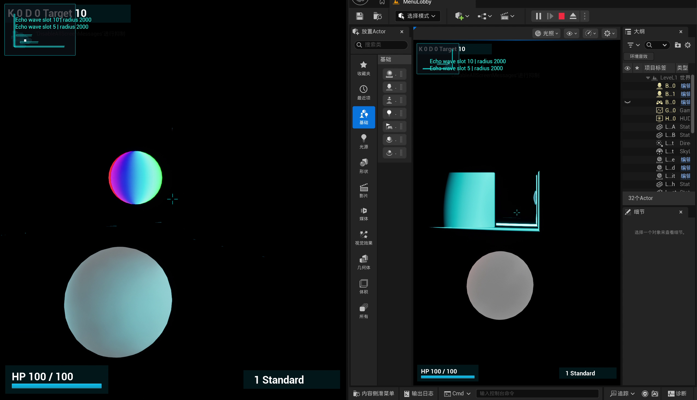

# BallDarkEcho — Echo-Based LAN Arena Game

[English](README.md) · [简体中文](README.zh-CN.md)

A Windows LAN arena game where movement, scanning and weapon fire expose players through echo waves and spatial sound. Built with Unreal Engine 5.7, C++ and Wwise 2025.1.8, it connects game-state information to what players can see and hear in a low-light arena.

[Watch the demo](1_Demo_Video/BallDarkEcho_Final_Demo.mp4) · [Windows build](2_Final_Build/BallDarkEcho_Windows_Development.zip) · [Game manual](3_UE_Project_and_Game_Manual/BallDarkEcho_Game_Manual.docx) · [Audio design](AUDIO_DESIGN.md)

## What the player does

- Host or join a LAN lobby, select a map and skill, ready up, then enter a deathmatch.
- Read cyan/blue waves for movement, scans and navigation; read red waves as weapon-fire exposure.
- Balance normal movement, sprinting and quiet movement against the information revealed to opponents.
- Switch between three weapon modes and use a selected character skill.
- Track health, kills, deaths and the match target, with respawn while the match is active.

## My contribution and background

This is my WM9M6 Games Engineering game project. My implementation combines the arena's echo-information rules, component-based gameplay, lobby and match flow, and the Unreal-to-Wwise integration. The audio work includes a Blueprint-callable C++ event component, position-based event posting, playing-ID stop/fade handling, and movement/weapon hooks.

Unreal provides the engine and networking foundation; Wwise provides audio authoring and playback. Those systems and any third-party assets are distinguished from my gameplay and integration code. The project's technical value is the connection between gameplay events, visual exposure and audio routing.

## How it works

| Technology or system | Role | Start reading |
| --- | --- | --- |
| Unreal C++ and Blueprint | Components, exposed settings and game-state interaction | [Source/BallDarkEcho](Source/BallDarkEcho) |
| LAN sessions and replicated gameplay | Lobby flow, server-side actions and shared match state | [EchoGameInstance.cpp](Source/BallDarkEcho/EchoGameInstance.cpp), [EchoDeathmatchGameMode.cpp](Source/BallDarkEcho/EchoDeathmatchGameMode.cpp) |
| Visual echo and weapon exposure | Emit readable waves from player actions | [EchoMovementPulseComponent.cpp](Source/BallDarkEcho/EchoMovementPulseComponent.cpp), [EchoWeaponComponent.cpp](Source/BallDarkEcho/EchoWeaponComponent.cpp) |
| Wwise event bridge | Resolve assigned events, post at locations and stop playback | [EchoAudioEventComponent.cpp](Source/BallDarkEcho/EchoAudioEventComponent.cpp) |
| Wwise authoring and SoundBanks | Configure events and supply Windows playback data | [Wwise project](BallDarkEcho_WwiseProject), [audio design](AUDIO_DESIGN.md) |

## Try the build or open the source

For the existing Windows 64-bit Development build, download the linked ZIP, extract it, and run `Windows/BallDarkEcho.exe`. Host and clients must share a LAN. The host creates a room; clients join and select **READY UP** before the host starts. The [quick guide](3_UE_Project_and_Game_Manual/README.md) explains the match flow.

The demo video and ZIP use Git LFS. When cloning, install Git LFS and run `git lfs pull`; small pointer files are not the actual video or build.

For source work, install Unreal Engine 5.7, the Visual Studio C++ toolchain and Wwise Unreal Integration 2025.1.8. Supply the locally installed Wwise plugins under `Plugins/`, open `BallDarkEcho.uproject`, and build `BallDarkEchoEditor Win64 Development`. The SDK installation is excluded. Keep the Unreal and Wwise relative paths intact.

Controls: WASD move, mouse aim, Space jump, left mouse fire, Shift sprint, Ctrl quiet movement, Q/1/2/3 weapon selection, R skill, and held Tab map.

## Status and limits

An existing demo video and Windows build are provided. This documentation refresh inspected the source and links; it did not re-run full Unreal or packaged multiplayer verification.

The shared audio event bridge and movement posting/stopping are implemented. Some event mappings, mix decisions and spatial-audio proposals still need individual authoring/playback verification. The `Loudness` argument is currently unused in the event bridge; it must not be described as a completed volume RTPC. [AUDIO_DESIGN.md](AUDIO_DESIGN.md) contains a dated June development snapshot and future design proposals, not a current all-features-passed report.

## Credits

Unreal Engine and Wwise have their own terms. Existing sound-source records are retained in [AudioSource/_licenses/sources.md](AudioSource/_licenses/sources.md), including unresolved entries. No new licence is granted for the combined game or its assets.
